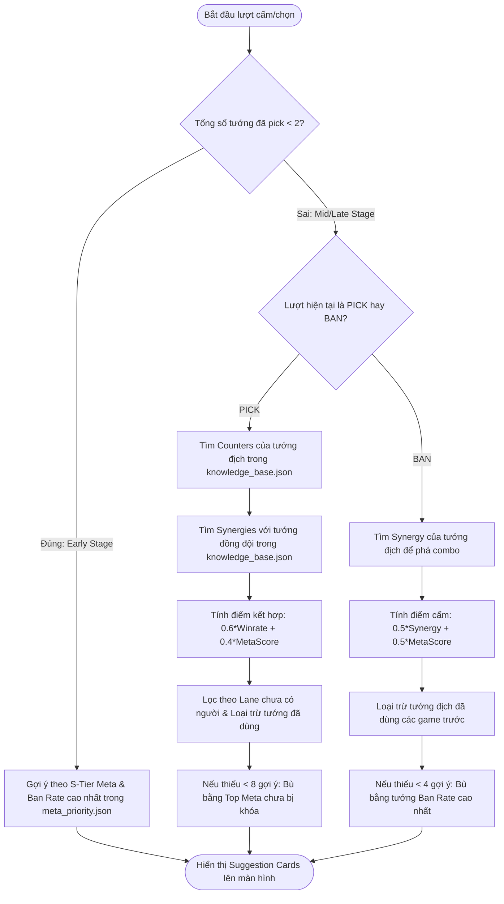

# 📋 BÁO CÁO TỔNG QUAN DỰ ÁN & CONTEXT CODEBASE: AOV COACH (KHANG'S AI)

* **Ngày cập nhật context:** 04/11/2026  
* **Tác giả dự án:** Khang  
* **Tên ứng dụng:** AOV Coach - Khang's AI (Arena of Valor AI Draft & Strategy Coach)  
* **Mục tiêu:** Hệ thống hỗ trợ Cấm/Chọn (Ban/Pick) và Phân tích Đội hình Liên Quân Mobile chuẩn Esports chuyên nghiệp, tích hợp luật Global Ban-Pick cho chuỗi trận BO3/BO5/BO7.

---

## 📑 MỤC LỤC
1. [Giới thiệu tổng quan dự án](#1-giới-thiệu-tổng-quan-dự-án)
2. [Sơ đồ kiến trúc hệ thống](#2-sơ-đồ-kiến-trúc-hệ-thống)
3. [Cấu trúc thư mục chi tiết (Project Directory Tree)](#3-cấu-trúc-thư-mục-chi-tiết)
4. [Phân tích chi tiết từng tầng hệ thống](#4-phân-tích-chi-tiết-từng-tầng-hệ-thống)
   - [4.1. Tầng Dữ liệu & Cào dữ liệu (Data & Web Scraper)](#41-tầng-dữ-liệu--cào-dữ-liệu)
   - [4.2. Tầng Trí tuệ & Máy học (Knowledge Base & Machine Learning)](#42-tầng-trí-tuệ--máy-học)
   - [4.3. Tầng Backend API (FastAPI Service)](#43-tầng-backend-api-fastapi)
   - [4.4. Tầng Giao diện người dùng (React Frontend)](#44-tầng-giao-diện-người-dùng-react-frontend)
5. [Các thuật toán & Logic nghiệp vụ cốt lõi](#5-các-thuật-toán--logic-nghiệp-vụ-cốt-lõi)
   - [5.1. Cơ chế Global Ban-Pick đa ván đấu](#51-cơ-chế-global-ban-pick-đa-ván-đấu)
   - [5.2. Thuật toán gợi ý Pick/Ban theo giai đoạn](#52-thuật-toán-gợi-ý-pickban-theo-giai-đoạn)
   - [5.3. Thuật toán phân tích đội hình & Tỉ lệ thắng](#53-thuật-toán-phân-tích-đội-hình--tỉ-lệ-thắng)
6. [Đánh giá hiện trạng & Nợ kỹ thuật (Technical Debt)](#6-đánh-giá-hiện-trạng--nợ-kỹ-thuật)
7. [Đề xuất các tính năng mới tiềm năng](#7-đề-xuất-các-tính-năng-mới-tiềm-năng)
8. [Hướng dẫn khởi chạy & Vận hành (Runbook)](#8-hướng-dẫn-khởi-chạy--vận-hành)

---

## 1. Giới thiệu tổng quan dự án

**AOV Coach** là công cụ mô phỏng phòng cấm chọn (Draft Room) chuẩn các giải đấu chuyên nghiệp của Liên Quân Mobile (Arena of Glory - AOG Việt Nam, GCS Đài Loan, RoV Pro League - RPL Thái Lan).

### 🎯 Các năng lực chính hiện tại:
1. **Mô phỏng quy trình cấm chọn 18 bước chuẩn quốc tế:** 2 lượt cấm đầu -> 3 lượt chọn đầu -> 2 lượt cấm sau -> 2 lượt chọn sau.
2. **Luật Global Ban-Pick cho chuỗi trận (Series Match):** Tướng đã dùng ở các ván trước sẽ tự động bị khóa trong các ván tiếp theo của cùng một đội.
3. **AI Gợi ý thời gian thực:**
   - Đề xuất tướng nên Pick dựa trên Meta, Counter tướng đối phương và Phối hợp (Synergy) với đồng đội.
   - Đề xuất tướng nên Ban dựa trên độ nguy hiểm (Ban Rate giải đấu) và phá hủy combo của đối thủ.
4. **Phân tích sức mạnh & Dự đoán tỉ lệ thắng (Winrate Prediction):**
   - Đánh giá chất tướng theo lối chơi: **Càn lướt (Dive)**, **Cấu rỉa (Poke)**, **Bảo kê (Protect)**.
   - Đưa ra lời khuyên chiến thuật (Win Condition) cho huấn luyện viên và tuyển thủ.
5. **Giao diện âm thanh sống động:** Tối ưu hóa UI/UX phong cách Esports hiện đại, có âm thanh khi chọn tướng (Pick Sound), nhạc nền (BGM) và tối ưu xoay ngang trên thiết bị di động.

---

## 2. Sơ đồ kiến trúc hệ thống

```
+-----------------------------------------------------------------------------------+
|                              DATA PIPELINE & TRAINING                             |
|                                                                                   |
|  [Garena LienQuan Web]       [Liquipedia Tournament HTML]                         |
|           |                                 |                                     |
|    get_heroes.py                    get_matches.py / extract_meta.py              |
|           v                                 v                                     |
|   (126 Heroes Info)                (308 Pro Matches + Meta Stats)                 |
|           |                                 |                                     |
|           +----------------+----------------+                                     |
|                            |                                                      |
|                            v                                                      |
|           +---------------------------------+                                     |
|           |     Knowledge Base Builder      |                                     |
|           |     (build_knowledge.py)        |                                     |
|           |  - Meta Heroes (Picks >= 5)     |                                     |
|           |  - Synergies (Winrate)          |                                     |
|           |  - Counters (Winrate > 50%)     |                                     |
|           +---------------------------------+                                     |
|                            |                                                      |
|                            v                                                      |
|           +---------------------------------+                                     |
|           |     Machine Learning Pipeline   |                                     |
|           |  (preprocess.py -> train.py)    |                                     |
|           |  One-hot 252 features           |                                     |
|           |  -> draft_ai_model.joblib       |                                     |
+-----------------------------------------------------------------------------------+
                             |
                             v
+-----------------------------------------------------------------------------------+
|                           BACKEND API (FastAPI - Port 8000)                       |
|                                                                                   |
|   GET /draft                                                                      |
|     - Đầu vào: your_team, enemy_team, bans, your_used, enemy_used                 |
|     - Logic: Filter Global Ban-Pick + Role/Lane Check + Score Ranking             |
|     - Trả về: pick_suggestions, ban_suggestions                                   |
|                                                                                   |
|   GET /analyze                                                                    |
|     - Đầu vào: your_team (5 picks), enemy_team (5 picks)                          |
|     - Logic: Đánh giá lối chơi (Dive/Poke/Protect) + Meta Diff + Quy luật khắc chế|
|     - Trả về: Lối chơi 2 bên, % Win Probability, Lời khuyên HLV                  |
+-----------------------------------------------------------------------------------+
                             ^
                             | HTTP GET (Axios)
                             v
+-----------------------------------------------------------------------------------+
|                        FRONTEND (React 18 SPA - Single Page)                      |
|                                                                                   |
|   - Screen 1: Màn hình bắt đầu trận đấu (Series Setup + BGM Control)              |
|   - Screen 2: Chọn phe Đội Xanh (First Pick) / Đội Đỏ (Counter Pick)              |
|   - Screen 3: Bàn Cấm/Chọn 18 bước (DRAFT_STEPS)                                  |
|       + Header hiển thị 8 lượt Cấm (Bans) + Timer 15s                             |
|       + Cột Pick Đội Xanh (Trái) & Cột Pick Đội Đỏ (Phải)                         |
|       + Panel giữa: AI Suggestion Cards + Search + Role Filters + Hero Grid       |
|       + Bảng phân tích Dashboard & Nút sang Game tiếp theo (Global Ban-Pick)     |
|   - LocalStorage Sync: Tự động lưu mọi thay đổi để không mất khi tải lại trang    |
+-----------------------------------------------------------------------------------+
```

---

## 3. Cấu trúc thư mục chi tiết

```text
d:\Khang\Work\AOV_Coach\
├── Notemd\                                  # [MỚI TẠO] Thư mục chứa tài liệu ghi chú dự án
│   └── AOV_Coach_Overview_2026-11-04.md    # Bản ghi chú tổng quan chi tiết này
└── aov-ai-coach\                            # Mã nguồn chính của dự án
    ├── .gitignore                           # Cấu hình bỏ qua .venv, node_modules, build, .env
    ├── data\
    │   └── sample_matches.json              # Mẫu dữ liệu test ván đấu (Ban/Pick/Winner)
    ├── backend\                             # Tầng Backend Python & AI Engine
    │   ├── requirements.txt                 # Thư viện: fastapi, uvicorn, pydantic, bs4, lxml, requests
    │   ├── main.py                          # File chạy API server (FastAPI, endpoints /draft & /analyze)
    │   ├── build_knowledge.py               # Xây dựng cơ sở tri thức (Synergy, Counter, Meta)
    │   ├── extract_meta.py                  # Bóc tách HTML Liquipedia thành dữ liệu meta_priority.json
    │   ├── update_meta.py                   # Script tự động tải & cập nhật meta trực tuyến (Draft)
    │   ├── preprocess.py                    # Tiền xử lý, chuẩn hóa tên tướng, mã hóa One-Hot ma trận
    │   ├── train.py                         # Huấn luyện mô hình ML (Logistic Regression, RF, XGBoost)
    │   ├── download_images.py               # Tải ảnh avatar toàn bộ tướng từ server Garena
    │   ├── data\                            # Kho lưu trữ dữ liệu xử lý của Backend
    │   │   ├── heroes.json                  # Dữ liệu 126 tướng (name, keyword, roles, avatar)
    │   │   ├── all_matches_master.json      # 308 ván đấu chuyên nghiệp đã cào từ giải đấu
    │   │   ├── knowledge_base.json          # Từ điển phối hợp (synergies) & khắc chế (counters)
    │   │   ├── meta_priority.json           # Điểm số meta, tỷ lệ Pick/Ban/Win của từng tướng
    │   │   ├── ml_dataset.csv               # Ma trận 308 ván x 253 cột phục vụ training
    │   │   ├── aog_heroes.html              # Trang HTML thống kê Đấu Trường Danh Vọng
    │   │   ├── gcs_heroes.html              # Trang HTML thống kê GCS Đài Loan
    │   │   └── rpl_heroes.html              # Trang HTML thống kê RPL Thái Lan
    │   ├── models\                          # Thư mục lưu mô hình đã huấn luyện
    │   │   ├── draft_ai_model.joblib        # Model máy học tốt nhất (LogisticRegression)
    │   │   └── feature_columns.joblib       # 252 tên cột đặc trưng của các tướng
    │   └── scraper\                         # Bộ công cụ cào dữ liệu thô
    │       ├── get_heroes.py                # Cào tướng & vai trò từ lienquan.garena.vn
    │       ├── get_matches.py               # Cào kết quả ván đấu, Ban/Pick từ file HTML giải đấu
    │       ├── aog_group1.html              # Dữ liệu HTML thô vòng bảng AOG
    │       ├── gcs_groupstage.html          # Dữ liệu HTML thô vòng bảng GCS
    │       └── rov_groupstage.html          # Dữ liệu HTML thô vòng bảng RoV
    └── frontend\                            # Tầng Giao diện người dùng React
        ├── package.json                     # Khai báo React 18, Axios, Lucide-react
        ├── package-lock.json
        ├── public\
        │   ├── index.html                   # HTML gốc
        │   ├── favicon.ico / favicon.png
        │   └── assets\
        │       ├── heroes\                  # Chứa ảnh avatar 126 tướng (.jpg theo keyword)
        │       └── sounds\
        │           ├── pick.mp3             # Hiệu ứng âm thanh khi bấm chọn tướng
        │           └── aovbgm_khangxsuno.wav# Bản nhạc nền phong cách Esports bản quyền
        └── src\
            ├── index.js                     # Điểm khởi động ứng dụng React
            ├── App.js                       # Logic chính toàn bộ màn hình, xử lý State & gọi API
            ├── App.css                      # Toàn bộ CSS phong cách Esports, Responsive Mobile
            ├── constants.js                 # Định nghĩa 18 bước cấm chọn chuẩn (DRAFT_STEPS)
            └── heroes.json                  # Dữ liệu tướng phía frontend để render nhanh
```

---

## 4. Phân tích chi tiết từng tầng hệ thống

### 4.1. Tầng Dữ liệu & Cào dữ liệu (Data & Web Scraper)
* **`scraper/get_heroes.py`:**
  - Cào trực tiếp từ Cổng thông tin Học viện Garena Liên Quân Mobile.
  - Sử dụng ánh xạ ID vai trò:
    - `28`: Đấu sĩ | `31`: Đỡ đòn | `29`: Pháp sư | `32`: Sát thủ | `30`: Trợ thủ | `33`: Xạ thủ.
  - Trích xuất được **126 tướng** kèm `name`, `keyword` (mã định danh), `roles` và đường dẫn ảnh đại diện gốc.
* **`scraper/get_matches.py` & `extract_meta.py`:**
  - Bóc tách cấu trúc HTML của Liquipedia (`brkts-popup-body-game`, `brkts-popup-mapveto__ban-round`).
  - Lấy thông tin đội xanh/đỏ, danh sách 5 pick, 4 ban mỗi bên và kết quả ván đấu (`left_won`).
  - Tổng hợp được **308 ván đấu chuyên nghiệp** từ các giải AOG, GCS, RPL.
  - Công thức tính điểm Meta (`meta_score`):
    $$\text{Meta Score} = (\text{Ban Rate} \times 1.5) + (\text{Pick Rate} \times 1.0) + (\text{Win Rate} \times 0.5)$$
  - Lưu kết quả vào `data/meta_priority.json` (hiện có 87 tướng xuất hiện trong meta thi đấu chuyên nghiệp).

### 4.2. Tầng Trí tuệ & Máy học (Knowledge Base & Machine Learning)
* **`build_knowledge.py`:**
  - Tính toán ma trận cặp tướng từ 308 ván đấu:
    - **`meta_heroes`:** Những tướng được pick $\ge 5$ lần kèm winrate.
    - **`best_synergies`:** Những cặp tướng cùng đội có $\ge 3$ trận cùng nhau kèm winrate.
    - **`best_counters`:** Những cặp đối đầu có $\ge 3$ trận và tỉ lệ thắng của tướng A khi gặp tướng B $> 50\%$.
  - Xuất ra tệp `data/knowledge_base.json`.
* **`preprocess.py` & `train.py`:**
  - Xử lý lệch tên giữa Liquipedia (quốc tế) và Garena (Việt Nam) qua từ điển ánh xạ tùy chỉnh (ví dụ: `doria` -> `dolia`, `kuangtie` -> `biron`, `ailin` -> `erin`, `riktor` -> `richter`, `zanis` -> `trieuvan`, `wirosableng` -> `wiro`).
  - Mã hóa 126 tướng x 2 đội = **252 đặc trưng nhị phân (One-Hot Encoding)** + 1 cột nhãn kết quả `Left_Win`.
  - Đánh giá 3 thuật toán:
    1. **Logistic Regression:** Phù hợp nhất với dữ liệu thưa (Sparse matrix) nhiều số 0, tránh hiện tượng overfitting. Đạt độ chính xác cao nhất và được chọn để lưu vào `models/draft_ai_model.joblib`.
    2. **Random Forest:** Hoạt động ổn định nhưng độ chính xác thấp hơn trên tập dữ liệu nhỏ.
    3. **XGBoost:** Dễ bị overfit khi tập dữ liệu chỉ có 308 mẫu.

### 4.3. Tầng Backend API (FastAPI)
File chính: `backend/main.py`.

#### 1. Endpoint `GET /draft`
* **Tham số nhận vào:**
  - `your_team`: Chuỗi các tướng đã pick của đội mình (ngăn cách bởi dấu phẩy).
  - `enemy_team`: Chuỗi các tướng đã pick của đối phương.
  - `bans`: Danh sách tướng đã bị cấm trong ván hiện tại.
  - `your_used`: Danh sách tướng đội mình đã sử dụng ở các ván trước trong series.
  - `enemy_used`: Danh sách tướng đội địch đã sử dụng ở các ván trước.
* **Xử lý vị trí đường (Lane Checking):**
  - Ánh xạ vai trò sang đường:
    - Sát thủ -> `Jung` | Pháp sư -> `Mid` | Xạ thủ -> `AD` | Trợ thủ/Đỡ đòn -> `SP` | Đấu sĩ -> `Top`.
  - Hàm `can_pick_for_lane(hero, occupied_lanes)` đảm bảo không gợi ý quá nhiều tướng trùng lane.
* **Giai đoạn đầu (Early Game: Tổng số pick < 2):**
  - Gợi ý Pick: Lấy các tướng có `meta_score` cao nhất chưa bị khóa.
  - Gợi ý Ban: Lấy các tướng có `ban_rate` cao nhất của đối thủ chưa bị khóa.
* **Giai đoạn giữa/cuối (Mid/Late Game):**
  - **Gợi ý Pick:**
    - Tính điểm Counter tướng đối phương đã chọn: $\text{Combined} = (WR_{\text{counter}} \times 0.6) + (\text{MetaScore} \times 0.4)$.
    - Tính điểm Phối hợp (Synergy) với đồng đội đã chọn: $\text{Combined} = (WR_{\text{synergy}} \times 0.6) + (\text{MetaScore} \times 0.4)$.
    - Bù (Filler) bằng các tướng Meta hàng đầu còn trống lane nếu danh sách gợi ý $< 8$.
  - **Gợi ý Ban:**
    - Tìm tướng đối phương có synergy cao nhất với tướng họ đã pick để cấm phá combo: $\text{Combined} = (WR_{\text{synergy}} \times 0.5) + (\text{MetaScore} \times 0.5)$.
    - Bù bằng các tướng có `ban_rate` cao nhất chưa bị khóa nếu danh sách $< 4$.

#### 2. Endpoint `GET /analyze`
* Chỉ chạy khi hai đội đã chọn đủ **5 vs 5**.
* Đánh giá lối chơi dựa trên các vai trò:
  - Sát thủ / Đấu sĩ -> Điểm **Càn lướt (Dive)**
  - Pháp sư / Xạ thủ -> Điểm **Cấu rỉa (Poke)**
  - Trợ thủ / Đỡ đòn -> Điểm **Bảo kê (Protect)**
* Lối chơi chiếm ưu thế là phong cách có tổng điểm cao nhất.
* Dự đoán tỉ lệ thắng:
  - Base winrate: $50\%$
  - Chênh lệch Meta Score: $\text{meta\_diff} = (TotalMeta_{your} - TotalMeta_{enemy}) \times 0.1$
  - Thưởng khắc chế lối chơi (Matchup Bonus): $+6\%$ nếu khắc chế theo vòng tròn Kéo - Búa - Bao:
    - **Càn lướt (Dive)** thắng **Cấu rỉa (Poke)**
    - **Cấu rỉa (Poke)** thắng **Bảo kê (Protect)**
    - **Bảo kê (Protect)** thắng **Càn lướt (Dive)**
  - Giới hạn tỉ lệ trong khoảng $[20\%, 80\%]$.
* Xuất lời khuyên chuyên môn (Win condition & Coach summary).

> [!NOTE]
> **Điểm đáng chú ý trong `backend/main.py`:**  
> Endpoint `/analyze` hiện tại đang dùng công thức **Heuristic Rule-Based** nói trên để tính tỉ lệ thắng và lối chơi, chưa gọi trực tiếp file mô hình Machine Learning `models/draft_ai_model.joblib`. Đây là cơ hội tối ưu hóa để kết hợp cả 2 phương pháp.

### 4.4. Tầng Giao diện người dùng (React Frontend)
* **Quản lý trạng thái đa ván (Series State Management):**
  - Sử dụng `localStorage` lưu trữ liên tục các khóa: `aov_inSeries`, `aov_gameNumber`, `aov_myTeamUsed`, `aov_enemyTeamUsed`, `aov_userSide`, `aov_currentStepIdx`, `aov_draftData`, `aov_analysis`, `aov_volume`.
  - Người dùng F5 hoặc tắt trình duyệt bật lại không bị mất trạng thái bàn draft.
* **Chuỗi cấm chọn (`constants.js`):**
  - Mảng 18 bước `DRAFT_STEPS` định nghĩa chính xác ai cấm, ai chọn theo thứ tự chuẩn thi đấu.
* **Bộ lọc và tương tác tướng:**
  - Tìm kiếm nhanh bằng tên hoặc keyword (ví dụ: gõ "nguyen vuong" hoặc "dyadia").
  - Thanh tab lọc 6 vai trò (Đỡ đòn, Đấu sĩ, Sát thủ, Pháp sư, Xạ thủ, Trợ thủ) có hiệu ứng ánh sáng vàng hắt sáng.
  - Tướng đã bị cấm, đã bị chọn, hoặc bị khóa do luật Global Ban-Pick sẽ tự động mờ đi (disabled) và không thể click.
* **Trải nghiệm âm thanh & Tối ưu hiển thị:**
  - Nút bật/tắt BGM kèm thanh trượt âm lượng (Volume Slider) lưu trong `localStorage`.
  - Âm thanh khóa tướng đanh gọn (`pick.mp3`).
  - Màn hình phát hiện chiều dọc điện thoại (`rotate-warning`) yêu cầu xoay ngang màn hình để trải nghiệm tốt nhất.
  - Khi xoay ngang điện thoại, CSS tối ưu ghim cố định (sticky) thanh cấm trên đầu và 2 cột pick 2 bên, cho phép cuộn độc lập danh sách tướng ở giữa.

---

## 5. Các thuật toán & Logic nghiệp vụ cốt lõi

### 5.1. Cơ chế Global Ban-Pick đa ván đấu
```text
Tập hợp tướng KHÔNG THỂ CHỌN đối với ĐỘI MÌNH:
  Unavailable(You) = CurrentDraftUnavailable ∪ MyTeamUsed

Tập hợp tướng KHÔNG CẦN CẤM (đối thủ không thể pick):
  Unavailable(Enemy) = CurrentDraftUnavailable ∪ EnemyTeamUsed

Trong đó:
  CurrentDraftUnavailable = BluePicks ∪ RedPicks ∪ BlueBans ∪ RedBans
  MyTeamUsed = Các tướng đội mình đã pick từ Game 1 đến Game hiện tại - 1
  EnemyTeamUsed = Các tướng đối phương đã pick từ Game 1 đến Game hiện tại - 1
```

### 5.2. Thuật toán gợi ý Pick/Ban theo giai đoạn



### 5.3. Thuật toán phân tích đội hình & Tỉ lệ thắng
1. **Phân loại phong cách chủ đạo:**
   - Mỗi tướng đóng góp 1.5 điểm vào trường phái tương ứng dựa trên `roles`.
   - Lối chơi của đội là $\max(\text{Dive}, \text{Poke}, \text{Protect})$.
2. **Quy luật Kéo - Búa - Bao:**
   - $\text{Dive} \succ \text{Poke}$ (Càn lướt khắc Cấu rỉa)
   - $\text{Poke} \succ \text{Protect}$ (Cấu rỉa khắc Bảo kê)
   - $\text{Protect} \succ \text{Dive}$ (Bảo kê khắc Càn lướt)
   - Bên khắc chế nhận thưởng $+6\%$ lợi thế, bên bị khắc trừ $-6\%$.
3. **Độ lệch Meta:**
   $$\Delta_{\text{meta}} = (\sum \text{MetaScore}_{\text{your}} - \sum \text{MetaScore}_{\text{enemy}}) \times 0.1$$
4. **Tỉ lệ thắng ước tính:**
   $$P_{\text{win}} = \text{clamp}(50.0 + \Delta_{\text{meta}} \pm 6.0, 20.0, 80.0)$$

---

## 6. Đánh giá hiện trạng & Nợ kỹ thuật (Technical Debt)

| Thành phần | Hiện trạng | Đánh giá | Hướng xử lý đề xuất |
| :--- | :--- | :--- | :--- |
| **API URL trong Frontend** | Hardcode `https://aov-backend-khang.onrender.com` trong `App.js` | ⚠️ Bất tiện khi chạy test local (phải sửa trực tiếp vào file hoặc phụ thuộc đường truyền internet của Render) | Tạo file cấu hình `.env` với biến `REACT_APP_API_URL` để linh hoạt chuyển giữa `localhost:8000` và Render. |
| **Tích hợp Model ML** | `draft_ai_model.joblib` đã huấn luyện xong nhưng `main.py` dùng Heuristic | ⚠️ Chưa tận dụng trọn vẹn sức mạnh của mô hình Machine Learning | Tích hợp song song: Dùng Heuristic cho giải thích chiến thuật (Qualitative) và dùng Model ML cho dự đoán Winrate chính xác hơn (Quantitative). |
| **Timer cấm chọn** | Hiển thị số `15` cố định | ⚠️ Chưa có đồng hồ đếm ngược thực tế | Viết hook đếm ngược `useTimer` (ví dụ 30s mỗi lượt), có âm thanh tíc tắc khi còn 5 giây. |
| **Chức năng Undo / Hoàn tác** | Chỉ có thể đi tiếp, nếu lỡ bấm nhầm tướng thì không quay lại được bước trước | ⚠️ Bất tiện trong quá trình thao tác nhanh | Thêm nút `Undo` quay lại `currentStepIdx - 1` và pop phần tử tương ứng trong `draftData`. |
| **Dữ liệu tướng trùng lặp** | `heroes.json` nằm ở cả `backend/data/` và `frontend/src/` | ⚠️ Khi thêm tướng mới dễ bị lệch giữa 2 bên | Đưa về một nguồn chung hoặc viết script sync tự động. |
| **Tên tướng quốc tế vs Việt** | Các file html scrape dùng tên quốc tế (Liquipedia), Garena dùng tên Việt | ⚠️ Một số tướng mới có thể bị bỏ qua nếu thiếu mapping | Bổ sung file cấu hình alias mapping độc lập (`hero_aliases.json`). |

---

## 7. Đề xuất các tính năng mới tiềm năng

Dựa trên nền tảng sẵn có rất vững chắc của ứng dụng, dưới đây là các tính năng mới có thể bổ sung trong các giai đoạn tiếp theo:

### 🌟 Nhóm 1: Nâng cấp trải nghiệm Cấm/Chọn (Draft UX Enhancements)
1. **Nút Undo / Đổi lượt chọn:** Cho phép HLV sửa sai khi bấm nhầm tướng mà không cần bắt đầu lại ván đấu.
2. **Bộ đếm thời gian thực (Countdown Timer):** Bộ đếm 30s/lượt kèm hiệu ứng thị giác và âm thanh cảnh báo khi sắp hết giờ.
3. **Chế độ Ban/Pick tự động với AI Bot (Solo Practice):** Người dùng chọn một bên, AI sẽ tự động tính toán và pick/ban cho bên còn lại để người dùng luyện tập tư duy cấm chọn.
4. **Tùy chỉnh thể thức thi đấu:** Hỗ trợ linh hoạt BO1, BO3, BO5, BO7, chuyển đổi có/không áp dụng luật Global Ban-Pick.

### 🧠 Nhóm 2: Tích hợp Trí tuệ Nhân tạo thế hệ mới (GenAI Coach)
1. **Trợ lý HLV LLM (AI Assistant Chat / Speech):**
   - Tích hợp Gemini API hoặc mô hình ngôn ngữ lớn để trả lời câu hỏi trực tiếp: *"Tại sao nên pick Yue trong kèo này?", "Đội hình này nên đánh mạnh ở giai đoạn nào?"*.
   - Phân tích chi tiết chất tướng: Tướng nào là mở giao tranh (Engage), tướng nào khống chế cứng (Hard CC), tướng nào đột biến sát thương.
2. **Gợi ý Trang bị & Phù hiệu khắc chế:**
   - Dựa trên đội hình đối thủ, gợi ý trang bị nên lên (ví dụ: đối thủ nhiều hồi phục thì gợi ý Sách Truy Hồn / Đao Truy Hồn; đối thủ nhiều sát thương phép thì gợi ý Huân Chương Troy).

### 📊 Nhóm 3: Quản lý dữ liệu & Báo cáo trận đấu (Data & Analytics)
1. **Lịch sử đấu & Xuất báo cáo (Export Match Summary):**
   - Cho phép xuất hình ảnh tổng kết ván đấu (Infographic) để chia sẻ lên mạng xã hội hoặc lưu trữ nội bộ đội tuyển.
2. **Cập nhật dữ liệu Meta tự động theo từng phiên bản (Patch Auto-Update):**
   - Module tự động quét số liệu từ các giải đấu đang diễn ra để cập nhật `meta_priority.json` theo từng phiên bản mới của game.

---

## 8. Hướng dẫn khởi chạy & Vận hành (Runbook)

### 8.1. Khởi chạy Backend (FastAPI)
Yêu cầu: Python 3.9+
```bash
# Di chuyển vào thư mục backend
cd d:\Khang\Work\AOV_Coach\aov-ai-coach\backend

# Cài đặt thư viện phụ thuộc (nếu chưa cài)
pip install -r requirements.txt

# Khởi chạy server FastAPI ở chế độ reload
uvicorn main:app --host 0.0.0.0 --port 8000 --reload
```
* API Docs Swagger UI: `http://localhost:8000/docs`
* Endpoint kiểm tra gợi ý: `http://localhost:8000/draft?your_team=Aya&enemy_team=Maloch`

### 8.2. Khởi chạy Frontend (React)
Yêu cầu: Node.js 16+ & npm
```bash
# Di chuyển vào thư mục frontend
cd d:\Khang\Work\AOV_Coach\aov-ai-coach\frontend

# Cài đặt node_modules (nếu chưa cài)
npm install

# Khởi chạy ứng dụng React
npm start
```
* Ứng dụng sẽ mở tự động tại: `http://localhost:3000`

### 8.3. Chạy Pipeline dữ liệu (Khi cần cập nhật dữ liệu mới)
```bash
cd d:\Khang\Work\AOV_Coach\aov-ai-coach\backend

# 1. Cào tướng mới từ Garena
python scraper/get_heroes.py

# 2. Tải ảnh đại diện tướng còn thiếu
python download_images.py

# 3. Gom và bóc tách các ván đấu mới từ thư mục scraper/
python scraper/get_matches.py

# 4. Tính toán Meta Score từ các file thống kê HTML
python extract_meta.py

# 5. Xây dựng lại cơ sở tri thức phối hợp và khắc chế
python build_knowledge.py

# 6. Mã hóa dữ liệu và huấn luyện lại mô hình ML
python preprocess.py
python train.py
```

---
*Tài liệu được khởi tạo và cấu trúc hóa để làm nền tảng vững chắc cho mọi công đoạn nâng cấp và phát triển tính năng tiếp theo.*


---

## 9. Nhật ký cập nhật: Giải pháp chống ngủ & Tối ưu Cold Start cho Render (04/11/2026)

### 9.1. Vấn đề thực tế
* **Cơ chế của Render Free Tier:** Dịch vụ web miễn phí sẽ tự động rơi vào trạng thái ngủ (**Spin Down / Sleep**) sau **15 phút** không có bất kỳ lượt truy cập HTTP nào.
* **Hệ quả UX:** Khi người dùng truy cập sau một thời gian dài, Render mất **~40 - 50 giây** để khởi động lại máy ảo (Cold Start). Điều này làm giao diện cấm chọn bị đơ, spinner chờ lâu và báo lỗi *"AI Coach đang bận..."*.

### 9.2. Kiến trúc giải pháp 3 lớp toàn diện (3-Tier Keep-Alive Solution)

```
[Layer 1: External Cloud 24/7]
  - GitHub Actions Workflow (.github/workflows/keep_alive.yml) hoặc UptimeRobot
  - Tự động ping mỗi 14 phút kể cả khi không ai mở trang web.
             │
             ▼
[Layer 2: Backend API Optimization]
  - FastAPI: GET /ping, /health, / cực nhẹ (trả về 200 OK trong < 1ms, không tốn RAM/CPU)
             ▲
             │
[Layer 3: Frontend UX Warm-up & Heartbeat]
  - Ngay khi mở web: Gửi ping ngay lập tức để đánh thức server sớm nhất có thể.
  - Heartbeat: Tự động gửi ping mỗi 13 phút trong lúc người dùng mở tab.
  - UI Badge: Hiển thị trạng thái kết nối trực quan (Sẵn sàng 🟢 / Đang khởi động 🟡 / Mất kết nối 🔴).
```

### 9.3. Các tệp đã được cập nhật
1. **`backend/main.py`:**
   - Thêm các route `@app.get("/")`, `@app.get("/health")`, `@app.get("/ping")`, `@app.head("/ping")` trả về `{"status": "ok", "message": "AOV Coach Backend is alive"}`.
2. **`frontend/src/App.js`:**
   - Cấu hình `API_BASE_URL` linh hoạt (hỗ trợ `process.env.REACT_APP_API_URL`).
   - Thêm `useEffect` Keep-Alive Heartbeat định kỳ 13 phút và Warm-up ping khi tải trang.
   - Thêm huy hiệu trạng thái `serverStatusUI` trên Màn hình khởi đầu và chấm trạng thái trên Bàn Draft.
3. **`frontend/src/App.css`:**
   - Thêm kiểu dáng phát sáng và hoạt ảnh cho `.server-status-badge` và `.draft-server-indicator`.
4. **`.github/workflows/keep_alive.yml`:**
   - Tạo mới file cấu hình GitHub Actions cron `*/14 * * * *` tự động curl `https://aov-backend-khang.onrender.com/ping`.
